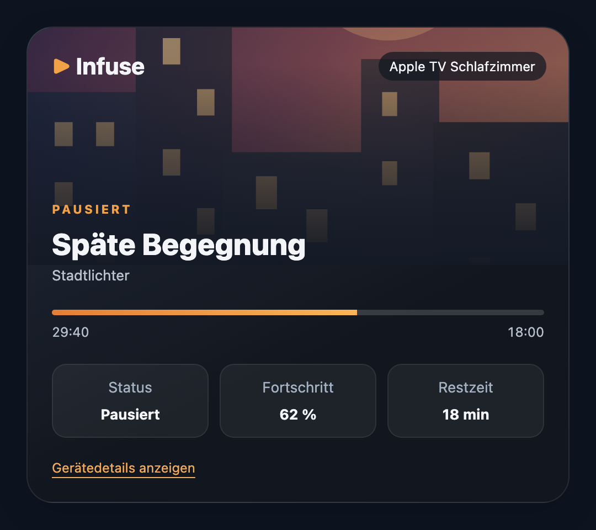
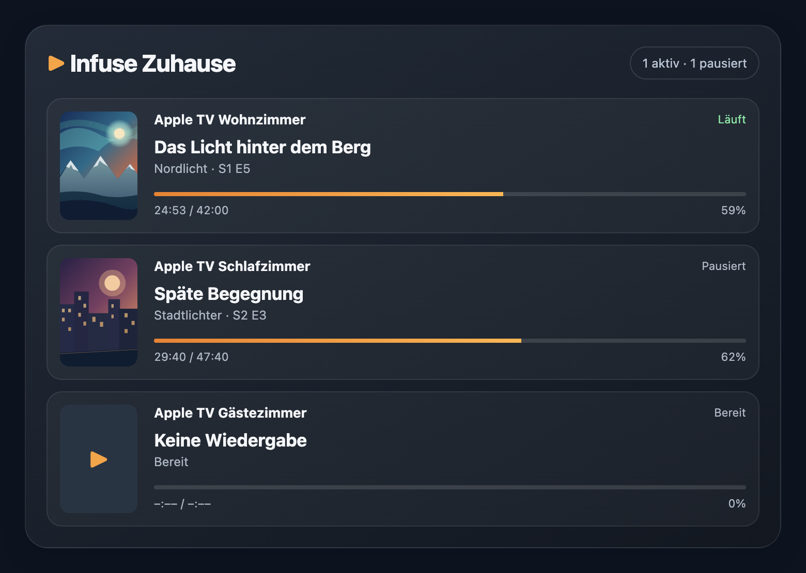

# Infuse Dashboard Cards

Optional, read-only custom dashboard cards for the [Infuse Now Playing Home Assistant integration](https://github.com/Manantra/ha-infuse).

## Preview

These are **screenshots of the real dashboard card JavaScript**, rendered with fictional example media and original illustrated placeholder artwork. They are not taken from a user's Home Assistant installation.

### Single-device card



*`custom:infuse-now-playing-card` — paused playback, artwork, title and configurable information tiles.*

### Multiple devices



*`custom:infuse-household-card` — multiple independent Infuse devices in one dashboard.*

<details>
<summary>How the preview images were created</summary>

The [HTML preview fixture](tests/preview-fixture.html) loads the actual distributed card JavaScript and supplies sample Home Assistant states. The sample series, titles and poster illustrations are fictional. The screenshots were taken in headless Chrome at 2× scale. To regenerate them, run `./scripts/generate-previews.sh` from the repository root with Chrome or Chromium installed.

</details>

**Home Assistant 2026.11+**: install this repository as category **Dashboard** in **Settings → Marketplace**. On **2026.10 or older**, add it in HACS as a **Dashboard** (formerly Lovelace/plugin) custom repository. This repository includes `hacs.json` for both stores.

The Marketplace installs `infuse-dashboard-cards.js` automatically, registers a versioned dashboard resource at `/local/community/ha-infuse-cards/infuse-dashboard-cards.js`, and keeps the card updated. An earlier manual copy to `/config/www/infuse-now-playing-card.js` is **not updated** by the Marketplace; remove its old `/local/infuse-now-playing-card.js` resource when migrating to the managed package, so an old JavaScript module cannot register the card before the new version does. Your existing dashboard YAML does not change.

Both components are bundled in a single JavaScript module:

- `custom:infuse-now-playing-card`: single-device cover, title, state (including Paused), progress and optional status/progress/remaining tiles. Its visual editor includes a searchable media-player entity picker and switches for each tile.
- `custom:infuse-household-card`: overview of multiple Infuse devices.

### Single-device card

```yaml
type: custom:infuse-now-playing-card
entity: media_player.apple_tv_infuse_player
title: Apple TV Wohnzimmer
show_status: true
show_progress: false
show_remaining: false
```

All three switches default to `true`; use the **visual card editor** to choose an entity and switch the optional bottom tiles on or off.

### Multiple devices

```yaml
type: custom:infuse-household-card
entities:
  - media_player.apple_tv_infuse_player
  - media_player.infuse_schlafzimmer
```

### Manual installation

Copy `dist/infuse-dashboard-cards.js` to `/config/www/infuse-dashboard-cards.js` and add `/local/infuse-dashboard-cards.js` as a JavaScript-module dashboard resource. Prefer the Marketplace or HACS to receive updates automatically.

**Source and release process:** the canonical integration repository is [Manantra/ha-infuse](https://github.com/Manantra/ha-infuse). The JavaScript source files in `examples/www/` are copied from there when publishing a new card release, then concatenated to `dist/infuse-dashboard-cards.js`. Both repositories retain the same `infuse-now-playing-card` and `infuse-household-card` element names for backward compatibility.
